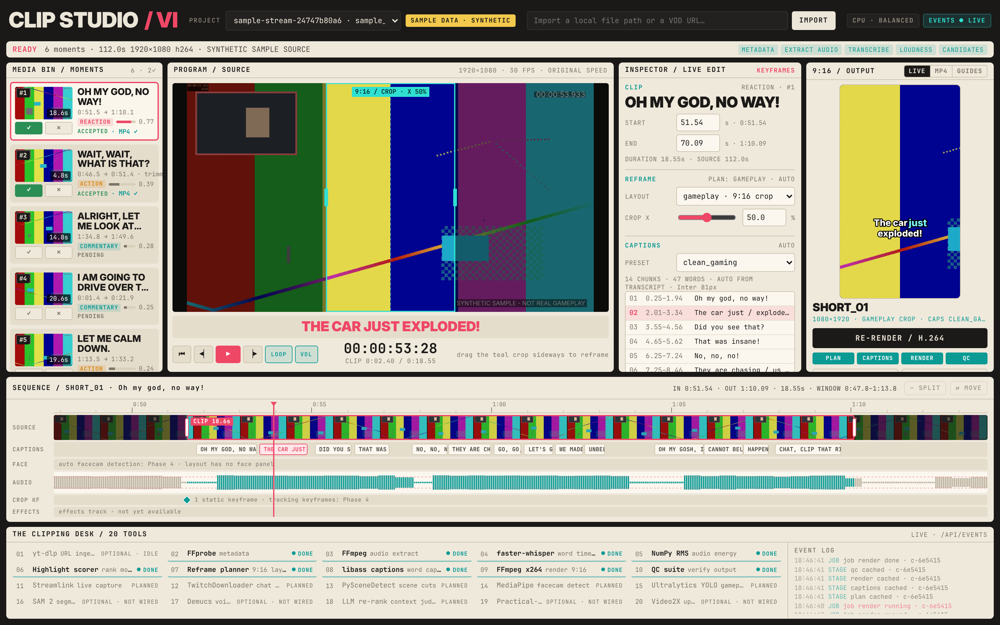

# GTA 6 Clip Studio

Local-first clipping studio for long gaming streams. Point it at a VOD and it
transcribes the stream, ranks the moments worth clipping, reframes them to
9:16, burns in word-timed captions, normalises the audio, renders H.264 MP4s
and checks every output with automated quality control. A local editing
workstation lets you review moments, move the crop, fix captions and re-render.

> **Status: Phases 1-5 working (first versions), plus the workstation UI.**
> Facecam auto-detection, gameplay tracking, visual/chat/LLM signals and
> audio/visual enhancements are built and tested on synthetic streams and the
> owner's own recordings, but not yet on a real GTA 6 stream with a webcam. See
> [DEVELOPMENT_STATUS.md](DEVELOPMENT_STATUS.md) for exactly what works.

- Architecture: [docs/ARCHITECTURE.md](docs/ARCHITECTURE.md)
- Decisions and tool evaluation: [TECHNICAL_DECISIONS.md](TECHNICAL_DECISIONS.md)
- Sandbox hardware report: [docs/ENVIRONMENT_REPORT.md](docs/ENVIRONMENT_REPORT.md)

---

## 1. Install

### Requirements

| | |
|---|---|
| Python | 3.10 or newer |
| FFmpeg + FFprobe | 5.0+ built with **libass** (for captions) and libx264 |
| OS | Windows 10/11, macOS 12+, Linux. CPU-only works; an NVIDIA GPU is optional |
| Disk | ~1 GB for models, plus space for VODs and renders |

### Installing FFmpeg

- **Windows:** `winget install Gyan.FFmpeg` (the "full" build includes libass), then open a new terminal.
- **macOS:** `brew install ffmpeg`
- **Ubuntu/Debian:** `sudo apt install ffmpeg fontconfig`

Check: `ffmpeg -hide_banner -filters | findstr ass` (Windows) or `| grep " ass "`. The doctor checks this too.

### Installing the studio

**Quickest:** clone the repo, then on Windows double-click
`scripts\windows\install.bat` once and `scripts\windows\Clip Studio.bat` to
start the workstation (it opens http://127.0.0.1:8765). On macOS/Linux run
`scripts/install.sh`. Both create `.venv`, install the studio with the UI,
facecam, URL and OCR extras, and run the doctor. (The Windows scripts are
written for Windows but were only tested in a Linux sandbox; report anything
odd.)

By hand:

```bash
git clone https://github.com/er1ck02/GTA-6-clip.git
cd GTA-6-clip
python -m venv .venv
# Windows: .venv\Scripts\activate      macOS/Linux: source .venv/bin/activate
pip install -r requirements.txt                 # core pipeline (CPU or GPU)
pip install -r requirements/ui.txt              # workstation UI (FastAPI + uvicorn)
pip install -r requirements/vision.txt          # facecam auto-detection (MediaPipe + OpenCV)
pip install -r requirements/ingest.txt          # optional: URL ingestion via yt-dlp
pip install -r requirements/llm.txt             # optional: LLM re-ranking with Claude
python -m app.cli doctor
```

`pip install -e ".[ui,vision,ingest]"` also works and adds a `clipstudio` command equivalent to
`python -m app.cli` (extras: `ui`, `vision`, `ingest`, `llm`, `ocr`, `all`, `dev`).

### Checking it on your own footage

```bash
python scripts/acceptance.py --input "D:/Videos/my_gta_stream.mp4" --check-install
```

runs the spec's 12 acceptance criteria against that video (import, analysis,
ranking, an edit, 9:16 reframe, word timing, audio, playback, QC, a real
interrupted render that is resumed, the documented commands, and a fresh-venv
install) and writes `acceptance_report.md`. Example:
[docs/acceptance/valorant_2026-11-21.md](docs/acceptance/valorant_2026-11-21.md).

### GPU setup (optional, NVIDIA)

faster-whisper uses CTranslate2, which needs the NVIDIA driver plus CUDA 12 and
cuDNN 9 libraries. The simplest route is `pip install nvidia-cublas-cu12
nvidia-cudnn-cu12` inside the venv (Linux), or installing the CUDA toolkit and
cuDNN on Windows. Then run the doctor: `cuda_ctranslate2` should report a CUDA
device. With a GPU, `processing.device: auto` picks CUDA and float16, and the
renderer uses NVENC when FFmpeg has it (falling back to libx264 if NVENC fails).

### Models

Nothing is downloaded at install time. On the first transcription,
faster-whisper downloads the chosen Whisper model from Hugging Face into
`models/whisper/`:

| Profile | Model | Download | Notes |
|---|---|---|---|
| `fast` | base | ~150 MB | multi-hour VODs on CPU |
| `balanced` (default) | small | ~500 MB | good accuracy, ~6x real time on a 4-core CPU |
| `quality` | large-v3-turbo | ~1.6 GB | best with an NVIDIA GPU |

Facecam detection uses MediaPipe's BlazeFace model (~230 KB), fetched once from
storage.googleapis.com into `models/vision/` (set `vision.download_models:
false` to forbid this; OpenCV's bundled Haar cascade is used instead).

To work offline, point at any local CTranslate2 Whisper folder:
`--set transcription.model=D:/models/whisper-small-ct2` (or env var
`CLIPSTUDIO_WHISPER_MODEL`).

---

## 2. Example workflow

```bash
# 0. check the machine
python -m app.cli doctor

# 1. analyse a VOD, rank moments, render the top 3 that pass the score threshold
python -m app.cli process --input "D:/vods/stream.mp4"

# 15-30 s clips, analyse only (no render yet)
python -m app.cli process --input stream.mp4 --min-duration 15 --max-duration 30 --top 0

# 2. review: list candidates with scores and reasons, accept/reject, trim, reframe
python -m app.cli review --project stream
python -m app.cli review --project stream --accept 1 3 --reject 2
python -m app.cli review --project stream --clip 1 --start 1834.2 --end 1861.0 --crop-x 0.42
python -m app.cli review --project stream --clip 3 --layout facecam_split --facecam 0.0,0.0,0.25,0.30

# 3. export accepted clips (or --clips c-1a2b3c, or --top N)
python -m app.cli export --project stream

# 4. after a crash or Ctrl+C, continue without redoing finished stages
python -m app.cli resume --project stream

# status of all projects / one project
python -m app.cli status
python -m app.cli status --project stream

# URL ingestion (needs yt-dlp; only content you have the right to download)
python -m app.cli process --url "https://www.twitch.tv/videos/123456789"

# the workstation UI at http://127.0.0.1:8765
python -m app.cli ui
```

Project ids can be shortened to any unique prefix (`--project stream`). Clip ids
can be the id (`c-1a2b3c`) or the rank shown in the table (`1`).

Outputs land in `data/projects/<project>/clips/<clip>/`: the MP4, `captions.srt`,
`captions.ass`, `cropplan.json` and `qc.json`. A clip whose QC fails is reported
as `FAIL` with the failing checks, and the command exits non-zero.

**Try it without a VOD:** `python scripts/make_sample_video.py data/sources/sample.mp4`
creates a clearly labelled synthetic "stream" (test pattern, fake facecam,
espeak-ng commentary with a loud reaction section). Requires `espeak-ng`.

---

## 3. CLI reference

| Command | What it does |
|---|---|
| `doctor` | Hardware, FFmpeg filters/encoders, Python deps, CUDA, fonts, models; writes `logs/doctor.json`. Exit 1 if something required is missing. |
| `process --input FILE... \| --url URL` | Ingest, analyse, rank and render the top N (`--top`, default `export.auto_render_top`). Several files or a folder = a batch (one project each; a failing file doesn't stop the rest). Options: `--chat FILE --min-duration --max-duration --target-duration --layout --caption-preset --facecam X,Y,W,H --platform NAME... --force`. |
| `review --project P` | Table of candidates plus reasons. `--accept/--reject CLIP...`, `--clip C --start --end --crop-x --layout --caption-preset --facecam`, `--cut FROM-TO` (repeatable, source seconds) and `--clear-cuts`. |
| `export --project P` | Render accepted clips, or `--clips ...`, `--top N`, `--all-accepted`. `--platform tiktok youtube_shorts instagram_reels` also writes per-platform copies. `--force` ignores caches. |
| `resume --project P` | Re-run analysis (cached stages skip) and re-render previously requested clips. |
| `status [--project P]` | Stage status, timings, errors, QC results. |
| `ui [--host --port]` | Start the workstation. |

Every command accepts `--config FILE` (repeatable), `--profile fast|balanced|quality`,
`--set key.path=value` (repeatable), `-v`, and `--json`: one JSON document on
stdout (logs stay on stderr), including errors as `{"error", "exit_code"}`, so
scripts and agents can drive the studio.

Platform copies (`export.platforms` in config, or `--platform`): each rendered
clip that passes QC gets `<clip>.<platform>.mp4` plus a `.json` with the title,
description, hashtags and ready-to-paste post text, under the clip's
`platforms/` folder. The copy is a stream copy when the master fits the
platform's limits and a constrained re-encode (fps cap, bitrate cap, trim to the
maximum length, with a warning) when it doesn't. The built-in limits
(`export.platform_presets`) are editable because platforms change them; nothing
is ever uploaded.

---

## 4. Configuration

YAML, validated on load (unknown keys and invalid values are errors). Precedence:
built-in defaults → profile → `--config` files (or `configs/default.yaml`) →
`--set` → environment variables (`CLIPSTUDIO_WHISPER_MODEL`, `CLIPSTUDIO_DEVICE`,
`CLIPSTUDIO_DATA_DIR`). Files: `configs/default.yaml` (all main keys,
commented), `configs/gaming.yaml` (facecam stream example),
`configs/captions.yaml` (custom caption preset example).

Main sections: `processing` (profile, device, resume/cache), `transcription`
(model, language, VAD), `highlights` (durations, threshold, max candidates,
duplicate overlap, **scoring weights**), `reframing` (layout, crop centre,
facecam region), `video` (1080x1920, fps), `captions` (preset, style overrides,
position, safe margins, profanity filter, SRT/ASS export), `audio` (LUFS
target, true peak, voice enhancement, game ducking), `enhance` (sharpen,
colour, punch-in zooms, hook title), `export` (encoder, CRF, preset,
auto render count), `quality` (QC thresholds). Full schema with defaults:
`clipstudio/config.py`.

Caption presets: `clean_gaming`, `bold_viral` (default), `minimal`,
`high_energy`, plus your own under `captions.presets`.

Layouts: `auto` (default: `facecam_split` when a facecam is found, else
`gameplay`), `gameplay` (9:16 crop that follows the action), `fit_blur` (whole
frame over a blurred fill: never cuts anything off), `facecam_split` (facecam
on top, gameplay below), `facecam_pip` (full-screen gameplay with the facecam in
a corner box).

Highlight signals: transcript and loudness always; plus, when available,
**visual** (`visual` section: one low-resolution pass over the whole video for
scene cuts, motion, flashes and colour-drained death/arrest screens such as
GTA's WASTED/BUSTED; with [Tesseract](https://github.com/tesseract-ocr/tesseract)
installed, on-screen words like WASTED, MISSION PASSED or ELIMINATED are read
too), **chat** (a chat replay next to the video, e.g. `my_vod.chat.json` from
TwitchDownloader, a chat-downloader JSON, a YouTube `.live_chat.json` from
yt-dlp, or a CSV with time and message columns; or `process --chat FILE`) and
an optional **LLM** re-ranker (`llm` section, off by default). Signals a source
doesn't have drop out of the weighting rather than scoring zero. Clip edges
snap to nearby scene cuts when that doesn't cut speech.

LLM re-ranking: set `llm.enabled: true`. Providers are tried in order:
`anthropic` (Claude via the official SDK, key from `ANTHROPIC_API_KEY`),
`openai_compatible` (any `/chat/completions` endpoint: set `base_url` and
`api_key_env`) and `ollama` (local, no key). The top `llm.top_k` candidates'
transcripts and signal summaries are sent to the provider; it scores, re-titles
and explains each, the answer is validated, and the final score blends both
(`llm.weight`). If every provider fails, the heuristic ranking is kept and the
log says why. Note that with a cloud provider the transcripts leave your
machine; use `ollama` to keep everything local.

Facecam and tracking (`vision` section): the facecam box is found once per
source from frames sampled across the whole video (a face that stays in one
place, plus the overlay's straight border). Only detections at or above
`vision.facecam_min_confidence` (0.6) are applied automatically; a bordered
panel without a face (a minimap, say) is shown in the UI but never used on its
own. A manual box (`reframing.facecam_region`, `--facecam`, or FACE BOX in the
UI) always wins. The gameplay crop follows on-screen motion with a deadzone,
speed limit and zero-lag smoothing; when the whole frame moves (camera pans in
shooters and driving) it holds its centre. Dragging the crop by hand pins it
for that clip.

Enhancements (`audio` and `enhance` sections), all applied in the same single
render pass: `audio.voice_enhancement` `light` (default: high-pass and gentle
compression) or `strong` (adds noise reduction, presence EQ and a de-esser).
With a separate mic track, the game audio is lowered while you talk
(`audio.duck_game`, `audio.duck_ratio`). The gameplay picture gets a quick
punch-in zoom on the clip's peak moment and on detected on-screen events
(`enhance.punch_zoom`, 1.0 turns it off; `enhance.punch_max`), plus light
sharpening and colour (`sharpen`, `contrast`, `vibrance`). `enhance.hook_title:
true` shows the clip title large at the top for the first seconds.

---

## 5. Workstation UI

`python -m app.cli ui` serves a local editor at http://127.0.0.1:8765 (bound
to localhost only). Panels: Program/Source preview with the real crop box and
facecam box over real frames, Media Bin of ranked moments, Inspector (layout,
crop, trim, cuts, caption preset and text, score breakdown), live 9:16 Output
preview with render, platform targets, downloads and QC report, a multitrack
timeline (source trims, cuts, caption timing, face, audio waveform, crop
keyframes, effects), and the Clipping Desk:
a live board of each pipeline stage/tool as it runs. Tools that are not
integrated yet are shown as planned, not as working.

Editing on the timeline: drag the clip edges to trim; **shift-drag** on the
SOURCE track to cut a section out of the middle (× on the hatched block
restores it; or MARK IN / MARK OUT / CUT in the Inspector); **✂ SPLIT** (S)
splits the clip in two at the playhead; **⇄ MOVE** (M) lets you slide the whole
clip along the source keeping its length. Playback skips cuts so you watch what
will render. The EFFECTS track shows punch-ins, the hook title and the audio
setup. **EXPORT ✓** in the Media Bin renders every accepted moment (one queued
job each, visible on the Clipping Desk), plus the platform copies selected
under the output preview.

HEVC recordings (common from Medal/NVIDIA) can't be played reliably by browsers,
so the server builds a 720p H.264 preview proxy for the editor the first time
you open the project. Renders always use the original file.



---

## 6. Tests

```bash
pip install -r requirements/dev.txt
python -m pytest tests/unit                      # fast, no media
CLIPSTUDIO_WHISPER_MODEL=/path/to/whisper-ct2 python -m pytest tests   # + real encodes
```

Integration tests synthesise a sample video (needs `espeak-ng`), run the full
pipeline, decode the real MP4s, interrupt a render and verify resume does not
re-transcribe, and check that QC fails a deliberately broken file.

---

## 7. Troubleshooting

| Symptom | Fix |
|---|---|
| `ffmpeg was not found on PATH` | Install FFmpeg (above) and open a new terminal. |
| doctor: `ffmpeg_filters missing: ass` | Your FFmpeg lacks libass. Use the Gyan "full" build on Windows or Homebrew/apt FFmpeg. |
| `could not load whisper model` on first run | No internet to Hugging Face. Download a CT2 model elsewhere and set `transcription.model` to its folder. |
| CUDA errors like `libcublas.so.12 not found` | Install CUDA 12 + cuDNN 9 libs (GPU setup above) or force CPU: `--set processing.device=cpu`. |
| Captions use a different font | The configured fonts aren't installed. Install one (e.g. Montserrat) or set `captions.style.font`. The doctor shows which font resolved. |
| `source file ... changed since project was created` | The VOD was edited or replaced. Process it again: it gets a new project id. |
| "no candidate reached minimum_score" | The heuristic found nothing strong; the best one is rendered for review. Lower `highlights.minimum_score` or adjust weights. |
| Windows path errors | Keep the repo in a short path such as `C:\clipstudio`. |

---

## 8. Known limitations

- Visual signals are generic image statistics (cuts, flashes, colour drain)
  plus optional OCR; they are verified on synthetic footage, not yet on real
  GTA 6 footage, whose HUD may differ. Score thresholds still need calibration
  on real streams.
- The LLM re-ranker is tested against local fake servers only; no real
  provider call has been made from the development sandbox.
- Record your mic on its own audio track if you can (OBS, SteelSeries and Medal
  support this): the mic track is detected by name and transcribed alone.
  With one shared track, in-game voice lines get transcribed too.
- Facecam detection needs a visible face. A camera that shows only hands, a
  VTuber avatar or a face turned away most of the time will not be found:
  draw the box by hand. It is verified on synthetic streams and on two real
  recordings without a facecam (correctly none found); it has not yet been
  run on a real stream with a webcam.
- Tracking follows motion, not objects: it cannot tell a car from an explosion
  next to it, and in first-person footage it deliberately holds the centre.
- No speaker diarization; single-language transcription per project.
- The UI's live 9:16 preview approximates the libass render; the rendered MP4
  and its QC report are authoritative.
- Splitting a clip into multiple segments and effects/transitions are not
  implemented.
- Tested on Linux (CPU) only so far; Windows/macOS paths are written to be
  portable but have not been run yet.

## 9. Licences and responsible use

This project's code is MIT. FFmpeg is LGPL/GPL depending on your build.
faster-whisper is MIT; Whisper model weights are MIT (OpenAI). Planned optional
modules have their own terms: Ultralytics YOLO is AGPL-3.0 (kept optional),
pyannote models used by WhisperX require accepting Hugging Face terms.
Downloading from YouTube or Twitch may be against their terms of service; only
clip content you have permission to use. Nothing here bypasses DRM or access
controls.
